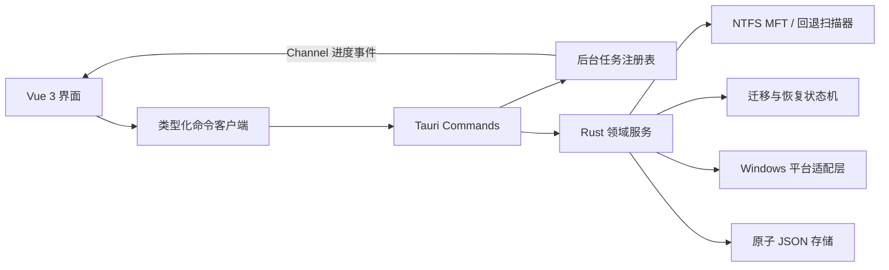

# DirMover 2.0 架构

## 目标

本次重构把单体 WPF 应用替换为边界清晰的 Tauri 桌面架构，同时保留空间扫描、跨盘迁移、目录联接、迁移记录、恢复与设置能力。旧 C# 源码已从当前树移除，但完整保留在 Git 历史中。



## 分层

| 层 | 位置 | 职责 |
| --- | --- | --- |
| 展示层 | `src/views`、`src/components` | 页面、表格、对话框、主题和交互状态 |
| 前端边界 | `src/services`、`src/types` | Tauri 命令封装、错误归一化、共享 DTO |
| 命令层 | `src-tauri/src/commands` | 输入校验、阻塞任务调度、Channel 事件 |
| 领域层 | `src-tauri/src/services` | 扫描、目标规划、迁移、还原和恢复 |
| 平台层 | `src-tauri/src/platform/windows` | MFT、卷信息、提权、Explorer、目录联接 |
| 持久层 | `src-tauri/src/storage` | 旧格式读取、进程内串行化、原子写入 |
| 任务层 | `src-tauri/src/tasks` | 任务生命周期、取消和有界历史 |

## 关键设计

### 扫描

- 启动只枚举一级目录，不递归计算。
- MFT 路径顺序读取卷元数据，并建立父子索引。
- MFT 权限或记录解析不可用时，回退扫描按一级目录并行执行。
- 链接不被跟随，扫描结果缓存在 Rust 进程内；分页和排序在 Rust 端完成。

### 迁移

状态流为：

```text
Preparing -> copy -> verify -> switch -> sync -> verify -> junction -> Active
Active -> restore copy -> verify -> switch -> cleanup -> removed/Restored
```

- 初次复制后校验，再把源目录重命名为同级备份。
- 最终同步发生在切换之后，避免漏掉复制期间的文件变化。
- 建立目录联接并验证目标后才标记为 `Active`。
- 中断记录可恢复；系统不会在无法判断安全路径时猜测或自动删除数据。

### 数据与 IPC

磁盘记录继续使用旧版 PascalCase 模型。面向 Vue 的 DTO 单独使用 camelCase，避免兼容格式泄漏到界面层。所有 Rust 错误被序列化为稳定的错误代码、用户消息和可恢复标记。

### 权限

默认 capability 只开放应用所需的核心窗口、目录选择和窗口状态权限。扫描提权采用显式用户动作；普通预览、设置、记录检查均在非管理员模式运行。

## 验证基线

- Rust：格式检查、Clippy `-D warnings`、单元测试。
- Web：Vue 类型检查、ESLint、Vitest、Vite 生产构建。
- Desktop：Tauri release 构建，并生成 NSIS/MSI 安装包。
