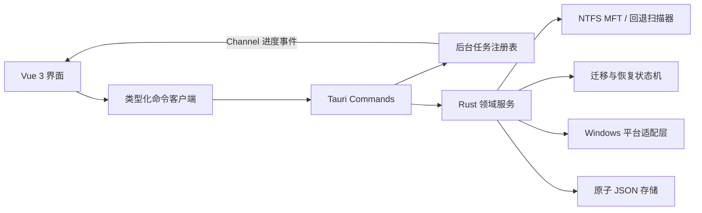

# DirMover 2.0 架构

## 目标

本次重构把单体 WPF 应用替换为边界清晰的 Tauri 桌面架构，同时保留空间扫描、跨盘迁移、目录联接、迁移记录、恢复与设置能力。旧 C# 源码已从当前树移除，但完整保留在 Git 历史中。



## 分层

| 层 | 位置 | 职责 |
| --- | --- | --- |
| 展示层 | `src/views`、`src/components` | 页面、表格、对话框、主题和交互状态 |
| 前端边界 | `src/services`、`src/types` | Tauri 命令封装、错误归一化、共享 DTO |
| 命令层 | `src-tauri/src/commands` | 输入校验、阻塞任务调度、Channel 事件 |
| 领域层 | `src-tauri/src/services` | 扫描、目标规划、迁移、还原和恢复 |
| 平台层 | `src-tauri/src/platform/windows` | MFT、卷信息、提权、Explorer、目录联接 |
| 持久层 | `src-tauri/src/storage` | 旧格式读取、进程内串行化、原子写入 |
| 任务层 | `src-tauri/src/tasks` | 任务生命周期、取消和有界历史 |

## 关键设计

### 扫描

- 启动只枚举一级目录，不递归计算。
- 非卷根目录先进行有界预判（最多 1024 个目录项、20 ms 时间预算），小目录直接遍历，避免为它读取全卷 MFT；预判不查询磁盘占用或进入链接目标。
- 较大范围的 MFT 路径顺序读取卷元数据，并建立父子索引。
- MFT 权限或记录解析不可用时，回退扫描使用共享目录队列。内部子目录也可由其他线程处理，统计结果按一级目录归属合并。
- 兼容扫描根目录只枚举一次，复用 Windows 目录枚举返回的元数据；磁盘占用仍使用原有查询，以保留压缩、稀疏文件的统计口径。迁移预检只计算逻辑大小，不查询未使用的磁盘占用。
- 链接不被跟随，扫描结果通过共享只读快照缓存在 Rust 进程内。总量只计算一次，排序索引按字段惰性缓存，分页只复制当前页的数据。
- 预览和扫描结果都以每页 500 项展示，支持跨页选择；异步分页请求按序号接收，较早的响应不会覆盖新结果。迁移使扫描快照失效后，界面返回目录预览。
- 扫描开始时记录缓存版本；迁移、还原和恢复结束（包括失败或取消）后推进版本。过期扫描不能发布结果或覆盖链接记录，前端通过统一的数据变更通知同步清理跨页面缓存。

扫描对比测试：`cargo test --manifest-path src-tauri/Cargo.toml --lib benchmark_space_analysis -- --ignored --nocapture`。测试创建自己的临时目录，以一万小文件的“多个一级目录”和“单个大型一级目录”两种结构，对旧版兼容扫描与新版扫描交替测量六轮，并核对统计结果。结果仅代表测试环境中的目录扫描耗时，不代表文件迁移速度。

### 迁移

状态流为：

```text
Preparing -> copy -> verify -> switch -> sync -> verify -> junction -> Active
Active -> restore copy -> verify -> switch -> cleanup -> removed/Restored
```

- 初次复制后校验，再把源目录重命名为同级备份。
- 最终同步发生在切换之后，避免漏掉复制期间的文件变化。
- 建立目录联接并验证目标后才标记为 `Active`。
- 中断记录可恢复；系统不会在无法判断安全路径时猜测或自动删除数据。
- 迁移、还原和恢复共用 FIFO 异步预约队列；仅取得执行权的任务进入阻塞工作线程。丢弃预约会跳过或释放执行权，不会留下队列空洞。
- 历史记录仅限制最近 64 个已结束任务。运行中、排队中，以及尚未被队列确认的取消任务不会因历史上限被移除。
- 任务百分比为可空值：只有可以测量的当前阶段提供百分比。MFT 读取与汇总提供阶段进度；目录遍历提供目录计数；迁移和还原显示阶段动画、步骤及执行耗时，不用固定阶段值估算剩余时间。
- 阶段变化和完成进度立即发送，80 ms 节流只用于阶段内更新。执行起点单独记录，排队时间不混入执行耗时；启动响应不能覆盖先到达的进度或终态事件。
- 取消与切换提交使用同一原子状态竞争；切换开始后 `canCancel` 为假，界面显示“安全收尾中”。`cancelRequested` 单独表示已接受的取消请求，迟到事件不能重新启用取消。
- 前端在提交扫描、还原、恢复和记录刷新前同步锁定按钮，失败后释放，避免命令响应前重复提交。
- 同一数据目录的 `operation.lock` 在迁移、还原或恢复期间排他持有；`storage.lock` 只保护短时 JSON 读写事务。另一个实例可启动并读取记录，操作冲突会明确报错。文件句柄关闭或进程退出后由系统释放锁，零字节锁文件保留供复用。
- `logs/diagnostics.jsonl` 保存阶段耗时、操作结果及 Robocopy 退出码和输出末尾；单个日志上限 1 MiB，保留一个轮换文件。每路输出最多缓存 16 KiB，日志写入失败不阻止迁移或恢复。

### 数据与 IPC

磁盘记录继续使用旧版 PascalCase 模型。面向 Vue 的 DTO 单独使用 camelCase，避免兼容格式泄漏到界面层。所有 Rust 错误被序列化为稳定的错误代码、用户消息和可恢复标记。

界面全量刷新以 120 ms 窗口合并，同一时间只保留一个请求；请求期间再次发生数据变更时，丢弃旧响应并补一次刷新。一次初始化或刷新共用一份磁盘清单与自动托管根，避免按分类重复探测磁盘。

### 权限

默认 capability 只开放应用所需的核心窗口、目录选择和窗口状态权限。扫描提权采用显式用户动作；普通预览、设置、记录检查均在非管理员模式运行。

## 验证基线

- Rust：格式检查、Clippy `-D warnings`、单元测试。
- Web：Vue 类型检查、ESLint、Vitest、Vite 生产构建。
- Desktop：Tauri release 构建，并生成 NSIS/MSI 安装包。
